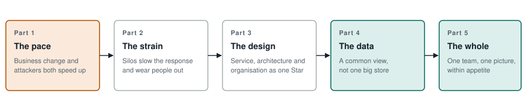
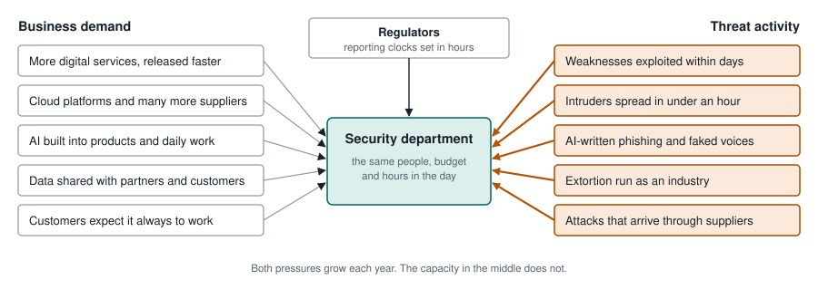
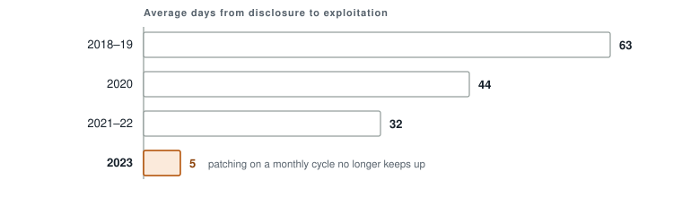
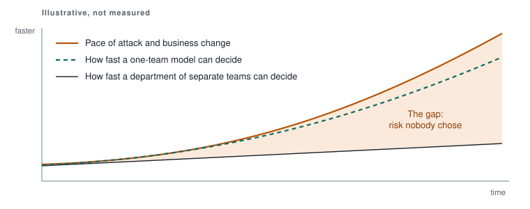
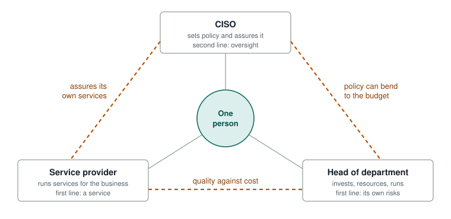
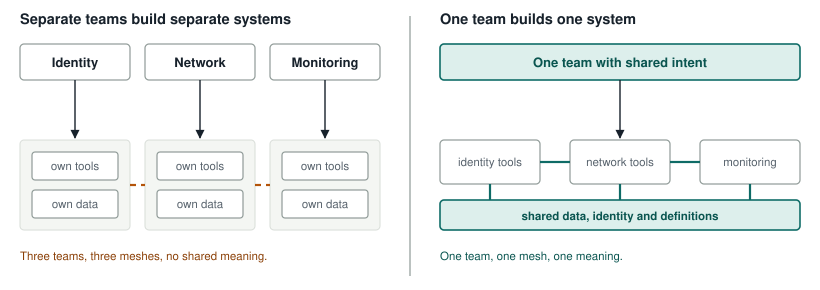
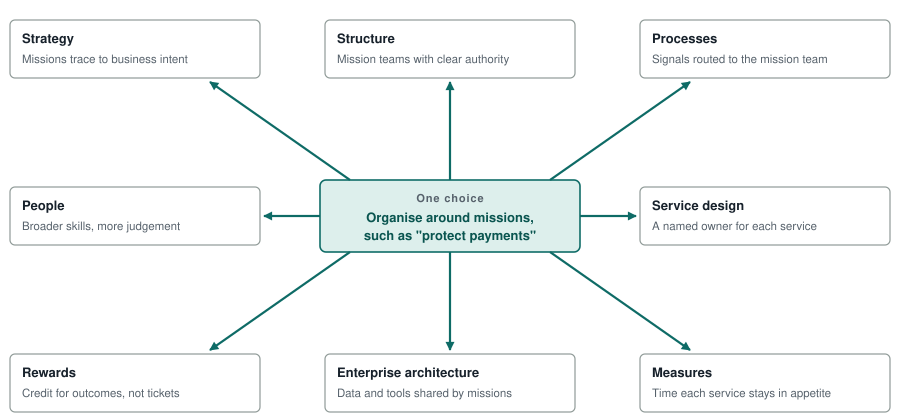

# Keeping Pace

*One operating model for a security department in an accelerating world, and why it has to be designed as a whole.*

*October 2026 · Master paper drawing together the earlier papers in this series*

## In brief

Business change and attacker activity are both speeding up, and a security department organised as a set of separate teams cannot keep up by working harder. It needs a different operating model: one team, working from one shared picture, acting within limits the business has set.

That model cannot be bought or decreed. It only comes about when three design disciplines work together. Service design says what the business actually needs from security. Enterprise architecture makes the shared picture and the tools possible. Organisation design shapes the teams, decision rights, rewards and skills that make people work as one. Each depends on the others. Jay Galbraith's Star Model, with its five points of strategy, structure, processes, rewards and people, is the frame that holds them together.

Underneath it all sits data. Not one giant store of everything, but a common view: shared definitions, open access, and a short list of critical questions that decides what reaches a decision-maker and what is handled locally. That thin layer is the "data spine" of the department.

The paper follows the argument in five steps.

**Figure 1.** The argument on one page. Each part answers the problem the one before it raises.

It keeps the starting point of every earlier paper. In a financial services firm the business owns the risk. Security's job is to help the business stay within the level of risk it has chosen to accept, its **risk appetite**, and not to replace that choice with its own.

The paper borrows from the armed forces in a few places, because they have spent a long time on one problem this department now has: how to get many separate teams to see one picture and act on it quickly without waiting for orders. Each military idea is explained in plain terms where it first appears, and is used only where it adds something a business framework does not.

## Part 1: The pace problem

The department is being squeezed from two sides at once. The business wants to change faster, and attackers are moving faster. Both trends are measurable, both are accelerating, and both land on the same people.

### Two accelerations, one squeeze

The first pressure comes from the business. A modern bank or insurer releases new digital services all the time. It runs on cloud platforms and on dozens or hundreds of suppliers. It is building artificial intelligence into its products and its everyday work. Each of these changes the shape of what must be protected, and each arrives faster than the last.

The second pressure comes from attackers. They are better organised, better funded and increasingly automated. Criminal groups sell ransomware and stolen logins as services to other criminals. AI tools write convincing phishing emails and fake voices. The time between a weakness becoming known and attackers using it has collapsed.

A third force sits above both. Regulators now expect firms to detect, decide and report on serious incidents within hours. That turns speed from a good idea into an obligation.

**Figure 2.** The squeeze. Business change and attacker activity push on the same department, while regulators set the clock it must work to.

### Attacks now move in days and minutes

The clearest measure of attacker speed is how long it takes them to use a newly known weakness. Google's Mandiant team tracks this as "time to exploit". In 2018 and 2019 the average was 63 days. By 2023 it was 5 days. In the same year, 70% of the weaknesses attackers used were "zero-days": flaws used before the software maker had released a fix.

**Figure 3.** Time to exploit has fallen from about two months to under a week. Source: [Google Cloud / Mandiant, How Low Can You Go? (2024)](https://cloud.google.com/blog/topics/threat-intelligence/time-to-exploit-trends-2023). The 2023 figure excludes 15 outliers; with them the average is 47 days.

Once inside, attackers move fast too. CrowdStrike measures "breakout time", how long an intruder takes to spread from the first machine they reach to others on the network. Its 2025 report put the average at 48 minutes, with the fastest case at 51 seconds. The same report recorded a 442% rise in voice-phishing calls in the second half of 2024, as attackers used phone calls and faked voices to talk staff into handing over access.

| Figure | What it measures |
| --- | --- |
| **5 days** | average time to exploit a new weakness in 2023, down from 63 |
| **48 min** | average time for an intruder to spread beyond the first machine |
| **51 sec** | fastest breakout CrowdStrike observed |
| **4 hours** | to tell the regulator once an incident is classed as major, under DORA |

These numbers come from vendors who sell defences, so they are worth treating with care. The direction, though, is not in doubt, and it is the direction that matters here. A process that needs a ticket, a weekly meeting and a sign-off before anyone acts is now slower than the attack it is meant to stop.

### The business moves too, and that is good

It would be easy to treat business change as the problem. It is not. The firm changes because customers expect it and competitors are doing it. Security exists so that the business can make those changes safely. A department that slows every change down is protecting the firm from its own strategy.

The business pressure shows up in a different way from the threat pressure. It arrives as volume: more projects asking for a security view, more suppliers to check, more systems to monitor, more access requests, more data flowing to more places. Each request is reasonable on its own. Together they fill every queue the department has. The earlier paper *Security Within the Business's Risk Appetite* put the business owner's need simply: "a fast, risk-informed answer when launching a product or changing a system". Speed is part of the service.

### Regulators have set the clock

Financial regulators have turned speed into a rule. The EU's Digital Operational Resilience Act (DORA) and the UK's operational resilience regime both expect firms to know which of their services are most important, to set a limit on how much disruption each can tolerate, and to report serious incidents fast. DORA's reporting deadlines are measured in hours.

**Figure 4.** DORA's reporting clock for a major ICT incident. Deciding whether an incident is "major" is itself a decision that has to be made quickly, by the right person. Source: [Austrian Financial Market Authority, summarising Delegated Regulation (EU) 2025/301](https://www.fma.gv.at/en/dora-ict-related-incidents/).

The hard part is not filling in the form. It is knowing, within a few hours, that something has become serious enough to report, and getting that fact to the person who must decide. That is an operating model question, and it comes back in Part 4.

### The gap that opens up

Put these together and a gap appears. The pace of attack and the pace of business change are both rising steeply. The speed at which a department organised in separate teams can notice, decide and act rises only slowly, because every signal has to travel through the organisation chart. The space between the two lines is risk the business never chose to take.

**Figure 5.** The gap is not closed by working harder in each team. It is closed by changing how the teams work together, which moves the department's line towards the faster one.

> **We need to do something, and the something is design. More tools and longer hours raise the bottom line a little. Only a different operating model raises it enough.**

## Part 2: Where today's operating models strain

Most security departments were designed for a slower world. They are organised as separate teams, each with its own tools, data and manager. That shape makes it hard to respond to fast-moving issues, and it makes the department hard to lead and hard to work in.

The problems fall into two groups. The first is about responding: how quickly a warning sign becomes an action. The second is about people: how the shape of the department affects the people in it. The two have the same root.

### Responding to issues

#### Information climbs up and crosses over

In a typical department, identity, networks, cloud, monitoring and policy are separate teams. People often call these teams "silos" or "stovepipes", because information travels up and down inside each one but rarely across. An attacker does not respect those boundaries. They move from a phishing email to a stolen password to a cloud server in an hour.

So when one team sees a warning sign that another team must act on, the signal has to climb one chain of command and come down another. Each step is a queue. Each manager sees only their own slice and has to be briefed before they can pass it on.

**Figure 6.** How a warning sign travels. On the left, the department moves at the speed of its organisation chart. On the right, it moves at the speed of its shared picture. Part 3 describes the design behind the right-hand side, and Part 4 the data that makes it work.

Shared tools alone do not fix this. A department can buy a platform that joins its tools together and still route every decision up the old chains of command. The previous paper, *Sensing and Responding*, made the point with Conway's law, which comes back in Part 3: teams that are organised separately build separate systems, even on a shared platform.

#### Services are framed as controls

Security departments usually describe what they do in the language of control frameworks such as the US National Institute of Standards and Technology (NIST) framework: identity and access management, vulnerability management, security monitoring. Those names describe the mechanism, not what the business is trying to do. A business owner does not want "vulnerability management". They want to know where their systems are exposed, in time to fix them before they move outside appetite.

When services are framed as controls, the department measures whether controls exist rather than whether the business is safe. It also starts to behave as if it owns the risk, which it does not. That makes responding harder, because the person who can accept a risk or take a service offline is not the person holding the information.

#### Risk decisions are made in the wrong place

Every delayed patch, every exception to policy, every decision to keep a system running during an incident is a risk decision. In a stovepiped department these decisions are often made quietly, inside a team, by someone who does not own the risk. Where security and technology are merged under one leader, the earlier paper's annex on the Chief Technology and Security Officer showed how far this can go: deferring a fix becomes a delivery decision and a risk decision at once, and the business owner who holds the risk may never see it.

#### Policy does strategy's job

Many security strategies are really lists of compliance goals. *Designing the Whole* drew the line clearly. Strategy chooses where to go: which services and risks matter most and what will not be done. Policy sets the edges of the road: what must always, or never, happen. When policy stands in for strategy, everything is treated as equally important. The department fights equally hard everywhere, which means it cannot go faster anywhere.

#### Everything escalates

When nobody has written down who may decide what, the safe choice is always to escalate. Leaders become a bottleneck, buried in issues they do not need to see while missing the few they do. In a fast-moving incident that is the worst of both worlds: too slow to act locally, too noisy to decide centrally.

### Managing people

The same shape that slows the response also makes the department hard to lead and hard to work in. Five strains stand out.

#### One person, three hats

The head of this department holds three distinct roles. As **CISO** (Chief Information Security Officer) they set security policy and check that it is followed. As **service provider** they run the services the business uses to meet that policy. As **head of department** they decide where the money and people go, within all the firm's other policies. The first is a second-line role in the firm's "three lines" of risk management, the oversight and challenge function. The other two are first-line roles, doing and owning.

**Figure 7.** Three roles, one person. None of this requires three people. It requires each conflict to be visible, so that it is settled in the open rather than privately. Under a combined technology and security leader, two more roles are added (technology provider and technology risk owner) and every tension gets sharper.

For the people in the department this is confusing as well as awkward. A business colleague asking for help is having a service conversation. A finding that they are breaking policy is an assurance conversation. If staff cannot tell which hat they are wearing, neither can the business, and trust suffers on both sides.

#### Measures that count activity

Most security dashboards count activity: alerts closed, patches applied, training completed. These answer "are we busy?" rather than "is the business safe?". They also invite the trap known as Goodhart's law: when a measure becomes a target, it stops being a good measure. A team rewarded for closing alerts quickly will close them quickly, whether or not the threat has gone. People learn to feed the dashboard rather than protect the firm.

#### Fear of reporting

In a regulated firm, finding a problem can feel like admitting a failure. Where risk and audit functions are seen as looking for fault, people stop surfacing issues. *Designing the Whole* drew on Matthew Syed's *Black Box Thinking* to make the contrast: aviation treats every near miss as information to share; healthcare historically treated errors as individual failings to hide. A department that cannot surface its own problems cannot learn, and a department that cannot learn cannot keep pace.

#### Unclear authority

Talented people want to use their judgement. When nobody has said what they may decide on their own, they either take risks they should not, or they escalate everything. Both are exhausting. The first leads to blame when something goes wrong; the second leads to frustration and slow work. The fix is not to tell people to "be empowered". It is to write down, in advance, where their authority starts and stops.

#### Change fatigue and reshuffled teams

Security departments are reorganised often, usually by moving people between boxes on the chart. People rarely resist change itself. They resist losing what made them effective: their team, their expertise, their sense of what good looks like. Keeping teams stable and moving the work to them is gentler and usually faster. So is saying plainly what is not changing: the purpose, the principles and people's standing.

#### One kind of work, one way of managing

Some security work is high-volume and repeatable, such as granting access or checking suppliers. It suits a production line with clear service levels. Other work is investigative and expert, such as threat intelligence, incident response and testing defences by attacking them. Managing both the same way frustrates everyone. Experts feel processed; production teams feel there is no standard to work to.

### One root cause: designed in pieces

Each of these strains has a local fix, and departments try them one at a time: a new tool, a new team, a new dashboard, a new reporting line. The fixes rarely stick, because the problem is not any single piece. It is that the pieces were designed separately and now pull against each other.

Jay Galbraith's Star Model, introduced fully in Part 3, makes this visible. It says an organisation has five design points that must line up: strategy, structure, processes, rewards and people. Map today's strains onto those points and every point turns out to be out of line, with the data that should connect them split between teams at the centre.

**Figure 8.** Today's strains mapped onto Galbraith's Star. The responding problems and the people problems are the same problem seen from different points.

> **The challenge is not to fix five things. It is to design one thing, so that each of the five points supports the others.**

## Part 3: A common operating model, and what it takes to build one

The answer to the pace problem is a common operating model: one way of working that the whole department, and the parts of the business it serves, share. Such a model cannot be drawn on a slide and rolled out. It only comes about when service design, enterprise architecture and organisation design are done together, because each one shapes the others.

### What an operating model is

An operating model describes how an organisation is set up to deliver its strategy. McMillan, Kesler and Kates, in *Rethinking Operating Models*, place it between strategy and organisation design. It is where the organisation decides how it will create value before it decides who reports to whom. Its choices include which capabilities set the organisation apart, what is done once at the centre and what is done many times locally, and which forums hold which decisions.

Every one of those choices is also a technology choice and a service choice. Deciding that a capability is shared implies shared data and shared platforms. Deciding where work sits decides how many hand-offs a business user meets, and whether anyone owns their experience from end to end. So the operating model is the one artefact that all three disciplines should write together. In most firms it is owned by none of them.

*Designing the Whole* offered a simple test of whether an operating model is finished:

| Discipline | Must be able to derive from the operating model |
| --- | --- |
| Enterprise architecture | A map of capabilities and a target state for data, applications and technology |
| Organisation design | Design criteria, structure options, decision rights and roles |
| Service design | Which services it delivers, to whom, and who owns each one end to end |

If any of the three cannot, it is a strategy statement, not an operating model.

### Three disciplines, one design

The three disciplines enter the same problem from different ends.

- **Service design** starts outside the organisation, with what a user is trying to do and the journey they take to do it. Lou Downe's definition in *Good Services* is the simplest: a service is something that helps someone do something. In this department the users are business owners, colleagues and sometimes regulators.
- **Enterprise architecture** starts from what the organisation must be able to do and the information and technology that make it possible: capabilities, data, applications, platforms. Eric Jager's guides to the TOGAF standard and Roger Burlton's *Business Architecture* are the main sources used in this series.
- **Organisation design** starts from how people must be grouped, connected, governed and motivated: structure, roles, decision rights, processes, rewards and skills. Galbraith and Cichocki are the main sources.

Each discipline has a blind spot, and it is always the other two. Architects draw capability maps that quietly assume today's structure. Organisation designers draw structures that quietly assume today's systems. Service designers redesign what users see without the authority to change what sits behind it.

A service blueprint, the service designer's main tool, shows how the three fit. It draws a service in layers: what the user does, what they see, the work staff do behind the scenes, and the systems underneath. Read from top to bottom, it is a cross-section of the whole organisation.

**Figure 9.** The working synthesis from *Designing the Whole*. Each discipline leads one layer. The test of the design is vertical: does the service work for its user from top to bottom, not is each layer tidy on its own.

A hand-off on a blueprint is usually a boundary between teams. A point where the user has to repeat information is usually a boundary between systems. That is where the three disciplines meet, and where a joint design either works or does not.

#### Desirable, feasible, viable

Design thinking offers a neat way to see why all three are needed. A good service is desirable (people want it), feasible (it can be built and run) and viable (it can be sustained). Each discipline speaks for one of those. *Designing the Whole* proposed a working rule: service design sets the test, and architecture and organisation design set the terms. The service decides what good looks like. The other two decide what it costs and whether it lasts.

**Figure 10.** Three forces in tension. Each edge is a tension to keep, not a problem to solve. If one side wins outright, the failure is predictable: bespoke systems that sprawl, users forced through the organisation chart, or a central bottleneck that every change queues behind.

### Conway's law: you design both whether you mean to or not

In 1968 the computer scientist Melvin Conway observed that organisations build systems that mirror their own communication structures. If four teams build a system, it will have four parts that talk to each other the way the four teams do. The observation has held up so well that it is now called Conway's law.

Read as a warning, it says that if you design the architecture without the organisation, or the organisation without the architecture, you have still designed both. You have just designed one of them by accident. Read as a tool, it says the opposite: shape the teams you want, and the architecture you want is more likely to follow. Software engineers call this the "inverse Conway manoeuvre".

**Figure 11.** Conway's law in a security department. Buying a platform that joins the tools does not join the teams. If the teams stay separate, the shared layer is shared only on the architecture diagram.

This is why the operating model this paper argues for cannot come from one discipline alone. A shared picture of threats needs architecture. People who use it as one team need organisation design. A picture that answers the business's real questions needs service design. Leave any one out and the other two drift back to the old shape.

### Galbraith's Star: the frame that holds it together

Jay Galbraith spent his career on one question: how to design an organisation so that its parts work together. His answer, the Star Model, set out in *Designing Dynamic Organizations*, has five points.

| Point | What it covers | The question it asks of this department |
| --- | --- | --- |
| Strategy | Direction, priorities, what will not be done | What matters most to the business, and how much risk is acceptable? |
| Structure | How people are grouped, and who holds power to decide | Are teams grouped by tool, or by the business outcomes they protect? |
| Processes | How work and information flow across the structure, including lateral links between teams | How does a warning sign become an action, and who is involved? |
| Rewards | What is measured, recognised and paid for | Do people get credit for protecting the business, or for being busy? |
| People | Skills, selection, development and mindset | Do people have the judgement and practice to act on their own? |

Galbraith's central point is that the five must be aligned. Strategy comes first, because it supplies the criteria for every other choice. Change one point without the others and the organisation pulls itself back. A new structure with old rewards produces the old behaviour in new boxes. New processes without new skills produce work-arounds. This is the symbiosis at the heart of the argument: no point can be designed on its own.

*Designing the Whole* made a further observation. The Star treats information and technology lightly, folding them into processes. Yet Galbraith's own earlier work treated organisations as systems for processing information. So information and technology are the Star's implied sixth point, at the centre, connecting the other five. That is exactly where enterprise architecture is strongest, and exactly where the Star is thinnest. Rewards and people, by contrast, barely appear in architecture frameworks, and that is where organisation design is strongest.

**Figure 12.** The Star as the integrating frame. Each discipline is strong where another is weak: architecture at the centre, organisation design at rewards and people, service design at the processes the user experiences. Together they cover all six points.

### One choice, many effects

The symbiosis is easiest to see by following a single decision around the Star. Take one that both earlier papers raised as an open question: should the department be organised by capability (identity, network, cloud) as today, or by mission (protect payments, protect customer data)?

**Figure 13.** Following one decision around the Star. If only the structure changes, the other seven pull it back: old rewards, old routes for signals, old data boundaries. The decision only holds if all eight move together.

This paper does not settle the capability-or-mission question. The likely answer is both: keep specialist capabilities as the enduring home for skills and tools, and form mission teams across them for the services that matter most. The point here is that whichever answer is chosen, it is a design decision for all three disciplines at once.

### The shape of the model: front, middle and back

*Designing the Whole* took a side on the shape. Services sit at the front, facing the business. A "security factory" of capabilities sits in the middle. Enabling functions, such as engineering and data, sit at the back. A business operations function runs across all three and owns the operating model itself.

**Figure 14.** Front, middle and back. The layers mirror the service blueprint: services at the front (service design leads), the factory in the middle (organisation design with architecture), enabling functions at the back (architecture leads). Business operations is the connective tissue across them.

Five seams need care. The factory must not become a ticket queue with the front reduced to a reception desk; service owners need a say in how factory capacity is used. Not all of the middle is a factory; investigative work needs expert cells managed differently. Governance, the "Govern" function added in version 2.0 of the NIST framework, belongs in business operations beside policy and risk appetite. Architecture is a discipline that works across all layers, not a back-office layer. And business operations, because it holds the money and the portfolio, must be measured on keeping the layers in balance, or it quietly becomes the real centre that decides everything.

### The business owns the risk: a rulebook through every layer

Everything above sits inside the firm's enterprise-wide risk management framework. The earlier paper *Security Within the Business's Risk Appetite* argued that this framework is not one of the layers. It is the rulebook that runs through all of them. It starts as the board's risk appetite and becomes a binding requirement at every level beneath.

**Figure 15.** The risk framework as a rulebook running through every layer. This is why a view of the department through NIST alone feels incomplete: NIST describes the controls well, but the framework that gives them their purpose and decides who answers for them belongs to the business.

The consequence for the operating model is direct. Security's services should be named for what the business owner is trying to do, not for the control they satisfy. "Vulnerability management" becomes "find and fix my weaknesses". "Control testing" becomes "show that I am within appetite". Each service should state its boundary: what security does, and what the business must still do itself. And each should be judged by whether the business stays within appetite, at an acceptable cost and friction.

### Direction and freedom: intent and authority set in advance

A common operating model only goes faster if people can act without waiting for permission. That needs two things the department rarely writes down: a clear direction that everyone can carry in their head, and clear limits on what each team may decide alone. The armed forces have thought hard about both, and this is where their experience adds the most.

> **Military idea · Commander's intent**
>
> A short statement of what a mission must achieve and why. The British Army defines it, at its simplest, as "a statement of the outcome that the Commander wishes to accomplish". A good one covers purpose, the few key tasks, and what "done" looks like. Its value shows when the plan breaks, as plans do: people can still act sensibly because they know what the plan was for. Officers are taught to understand the intent of the leaders two levels above them, not just their own boss.

> **Military idea · Mission command**
>
> The British Army's way of leading. Leaders say what must be achieved and why, provide the resources, and leave the how to the people closest to the problem. It traces back to the Prussian army of the 1800s, for a practical reason: by the time a request for orders went up the chain and back, the situation had changed. It asks more of leaders, not less. They must state intent clearly, set limits clearly, trust people's judgement, and stay informed enough to step in.

> **Military idea · Arcs of fire**
>
> The sector a soldier may fire into without asking. Inside the arc they act on their own judgement; outside it they must ask. The arc is set in advance and everyone knows it. In a bank, the business's risk appetite is the natural source of the department's arcs.

**Figure 16.** Direction and freedom. Intent is written at each level inside the one above, so a team can trace its purpose back to the business. The arcs say in advance what the team may do alone and what must go to the risk owner. The wording is illustrative; the business owner and security would agree the real split.

A plausible chain of intent for payments might read:

| Level | Who writes it | Example intent |
| --- | --- | --- |
| Firm | Board and executive | Grow digital payments while staying within agreed risk appetite and impact tolerances |
| Business service | Payments risk owner | Customers can always make payments; no outage beyond the agreed tolerance; no material fraud loss |
| Security department | Head of security, in all three roles | Keep the firm's most important services within appetite by seeing threats early and acting before harm is done |
| Security team | Team lead | No attacker keeps a foothold in the payments environment beyond an agreed time |

The examples are placeholders, not recommendations. What matters is the shape: each line traces to the one above, and the business owner's line is where security's purpose comes from. Stephen Bungay's *The Art of Action* explains why this works in business as well as in the army. Plans fail in three gaps: between what we know and what we would like to know, between the plan and what people do, and between what we expect to happen and what does. Tighter control widens those gaps. Clear intent, passed down and checked back, narrows them.

David Marquet's *Turn the Ship Around!* adds the necessary warning. Control can only be pushed down as fast as competence and clarity go with it. Pushing it down without them is abdication, not empowerment. That is why intent and arcs must be paired with training and rehearsal, which is the people point of the Star.

### Two loops, one picture

With direction and freedom in place, the department can run continuously rather than in bursts. The paper *Sensing and Responding* described this as two loops running off one shared picture.

The slow loop is **Continuous Threat Exposure Management (CTEM)**, a way of working Gartner described in 2022. It constantly asks: if someone attacked us today, where could they get in, and would it matter? Its five stages are scoping (with the business, what matters most), discovery, prioritisation by business harm, validation (testing whether an attacker really could get in) and mobilisation (getting the right people, often outside security, to fix it).

> **Military idea · The OODA loop**
>
> A model of decision-making under pressure developed by John Boyd, a US Air Force pilot and strategist: observe, orient, decide, act, then go round again. It is often summed up as "go round faster than your opponent". Boyd's own later point was more useful. The key step is orient, making sense of what you see. When a group shares the same understanding and the same idea of what matters, people can act without asking, because they already know what their leader would want. Speed follows from shared understanding.

The fast loop is the response to an attack in progress, which follows Boyd's cycle. Both loops draw on and feed the same picture, and both work under the same business intent.

**Figure 17.** Two loops, one picture, from *Sensing and Responding*. The slow loop finds weaknesses before attackers do. The fast loop stops attacks as they happen. Both draw from and act through a team that reaches well beyond the security department.

CTEM's hardest stage is mobilisation, because the people who must make the fix usually sit outside security. That is an organisation design problem, not a technology one, and it only works if the department and its colleagues behave as one team rather than security sending tickets over a wall.

### Making the three hats visible

The common operating model also gives the three roles of the head of security a clear place. Galbraith's point applies directly: when structure cannot separate roles, processes and lateral mechanisms have to.

| Role | Place in the operating model | Forum where it is exercised |
| --- | --- | --- |
| CISO | Helps the business write its security intent and critical questions; checks that both loops stay within policy | With the risk function, as part of the firm's risk framework |
| Service provider | Runs the front-layer services, the shared picture and both loops for the business | Service reviews with the business owners who use the services |
| Head of department | Designs the five points of the Star so the department can run the model; invests in tools and people | Business operations, under the risk framework like any other business unit |

Two safeguards follow. Business owners should always know which hat they are talking to. And traceability from policy to service, described in Part 4, should make visible wherever the CISO is checking the provider's own work, so that independent assurance from the risk function or internal audit can be pointed there. Where security and technology are combined under one leader, this matters even more: the CISO role is the one that most needs an independent line.

## Part 4: Data: a common view, not a common store

Data sits at the centre of the Star and underneath every part of the operating model. The shared picture, the two loops, mission command and the business's view of its own risk all depend on it. But the answer is not to pour all the data into one place. It is to give everyone a common view: shared definitions, open access, and a short list of questions that decides what matters.

### Why data is the hub

Go back to the signal in Figure 6. On the left, the warning travelled slowly because each team held its own data in its own terms, and only managers could translate between them. On the right, it travelled quickly because everyone could see the same picture, described the same way. The difference was not the people or the tools. It was whether the data was shared in a form everyone could use.

The same is true across the operating model. Service owners need data to show the business it is within appetite. Architects need it to trace risks to controls to systems. Organisation designers need it to give teams the information that lets them decide locally. Leaders need it to know when to step in. Each discipline needs the data for a different reason, and each will build its own copy if there is no common view.

### Three ways to hold the data

Departments usually take one of three approaches.

**Figure 18.** Three ways to hold security data. The third keeps each team's data close to the people who know it best, while making it readable by everyone else. It is cheaper than the second and far more useful than the first.

The first is where most departments start. The second is the usual reaction: a programme to copy everything into a central store. It is slow and expensive, and it often disappoints, because data copied into one place is still described in many different ways. The store becomes a bigger silo.

The third is the approach this paper argues for. Data stays with the teams and tools that produce it. What is shared is the meaning (one identity for each person and system, one list of critical services, one way of rating severity) and the right to read it. A common view reads across all of it. Two pieces of military experience show why this works.

> **Military example · Ukraine's Delta system**
>
> Delta is a computer system used by Ukraine's armed forces since 2022. Think of it as a live shared map of the battlefield, a little like a navigation app that shows traffic reported by other drivers. Units, drones, satellites, allies and vetted members of the public add what they see, and everyone with access can see the result and plan on it. Ukrainian officials say it cut the time from spotting a target to acting on it from as much as 72 hours to about two minutes. Those are their figures, not independently checked. The lesson for a bank is how it worked: it was designed to share rather than hoard, everyone who contributes also benefits, and machines take the first look so people can concentrate on judgement.

> **Military guidance · UK Joint Doctrine Note 1/23**
>
> In 2023 the UK Ministry of Defence published short guidance on intelligence, surveillance and reconnaissance (ISR): gathering information and working out what it means. Two of its points carry straight across. First, it says ISR should not be "artificially divided" between land, sea, air or levels of command. Swap those for cloud, laptops and identity and it is the case against silos in one sentence. Second, it says making sense of information is "not subordinate to collection", and prefers models where many teams share and analyse it together. The data does not belong to whoever collected it.

### The data spine

Sharing everything creates a new problem. A bank produces billions of log lines, thousands of alerts and hundreds of reports a day. If everyone adds everything and everyone sees everything, nobody sees anything. Security teams already know this as "alert fatigue".

The paper *Signal, Not Noise* proposed an answer: a "data spine". A spine is not the whole body. It is the small, rigid part everything else attaches to. In data terms it has three parts.

1. **The questions.** A short, agreed list of critical questions, each with an owner, the decision it serves, a threshold and a review date. This list changes on purpose and rarely.
2. **The shared definitions.** To recognise an answer automatically, every tool must describe the world the same way: one identity for each person and system, one list of critical services, one severity scale. Without this, the same event looks different in every team's tool and no rule can catch it.
3. **The sorting rules.** The triage logic that says what counts as an answer, who must hear, how fast, and by which route.

**Figure 19.** The data spine from *Signal, Not Noise*. Intent goes down as questions; only answers come back up. Everything else is either handled by the team that owns the mission, or recorded in the common picture where analysts, risk and audit can still see it.

### Critical questions: what the military calls CCIRs

> **Military idea · Commander's Critical Information Requirements (CCIRs)**
>
> A CCIR is a question a leader has said, in advance, they must have answered, because the answer will change a decision they have to make. Anything that answers a CCIR goes straight to them. Everything else does not. A staff officer will often describe them as "the things you wake the commander up for". Doctrine splits them into questions about the other side (priority intelligence requirements, PIRs) and questions about our own forces (friendly force information requirements, FFIRs). A related list, essential elements of friendly information (EEFIs), says what the other side must never learn about us.

This is the idea that turns a shared picture into something people can work with. A CCIR does three jobs at once. It points the sensors at what matters first. It tells everyone, without asking, what to push up and what to keep local. And it protects mission command: because everyone knows what the leader must hear, the leader does not need to hear everything else.

Good CCIRs share five tests. Each is tied to a decision. Each is a question that can be answered yes or no. Each is specific about time, place and thing. Each has a shelf life, after which the answer no longer helps. And there are few of them; a long list stops filtering.

In a bank there are two kinds of commander. The business risk owner decides how much risk to run; the head of security decides how to run the department. Each needs a short list. Here is how the three parts translate, with an illustrative example for payments.

| Part | In a security department | Example, written as a question | Decision it serves |
| --- | --- | --- | --- |
| Threat questions (PIR) | What attackers are doing, or could do, against the services that matter most | Is there evidence an attacker has access to the live payments environment? | Switch to the backup payments route |
| Own-defence questions (FFIR) | The state of our own monitoring, controls and people | Has monitoring covered less than the agreed share of payments systems for more than a day? | Fund extra monitoring, or pause a change |
| Own-defence questions (FFIR) | Externally set thresholds | Has this incident met the firm's threshold for a major incident? | Notify the regulator within DORA's hours |
| What to guard (EEFI) | What we must never let an attacker learn | Details of monitoring gaps and of any live investigation in payments | Guarded, not reported |

Most banks already have key risk indicators (KRIs), which track risk levels over time against appetite. CCIRs do not replace them. A KRI shows which way the trend is going. A CCIR says a decision is now due. A KRI crossing its appetite limit is one of the most natural CCIRs a business owner can have, so the two should be designed together, from the same risk appetite statement.

### Triage: sorting by urgency

Medical triage sorts patients by how urgently they need care, not by who arrived first. The data spine does the same with signals, in three sifts.

**Figure 20.** Three sifts. Machines remove most of the noise, as Delta's software scans video for vehicles so people can concentrate on judgement. Mission teams handle what falls within their arcs. Leaders are interrupted only when a critical question is answered, or when a team judges something so unusual that the questions themselves may be wrong.

That last case is valuable in its own right. An escalation that does not match any CCIR tells the leader the list needs updating. And because nothing is thrown away, analysts can still look for slow patterns, and risk and audit can check that the filter is honest. The filter decides what interrupts people, not what is kept.

### Traceability: from risk to service

The common view needs one more thread running through it. Every security service should be traceable to a risk the business owns, through the control it supports and the place that control lives. Enterprise architecture is the discipline that can hold this chain together.

**Figure 21.** The traceability chain from *Security Within the Business's Risk Appetite*. It is what lets a deferred fix reach the business owner who actually holds the risk, instead of stopping inside a technology or security team.

Traceability also does the job the three hats need. Where the chain shows the CISO assuring a service the same person provides, independent assurance can be pointed there. And it shows the business, in its own terms, which of its risks depend on which services, so it can accept or reject a risk knowingly.

### Measures: the mission, not the activity

If the critical questions say what matters, measures should say whether the mission is being achieved. A department built this way needs measures at three levels, each with a different reader.

**Figure 22.** Three layers of measure from *Signal, Not Noise*. The top layer matters to the business. The bottom layer is how teams manage themselves under mission command, and should mostly stay with them. The middle layer is new: it checks whether the data spine itself works.

The middle layer tracks five things: how long it takes from a critical question being answered to the decision-maker knowing (the security version of Delta's spot-to-act time); misses found only afterwards; false alarms; escalations that matched no question; and questions that never fire. The same data shows whether mission command is working. If almost every action goes up for approval, the arcs are too narrow or not trusted. If teams regularly act outside them, the arcs are unclear. Both are design problems, not discipline problems.

*Designing the Whole* added a second rule: pair measures across each tension, so that one side cannot improve by hiding the cost in another.

| Tension | What drift looks like | Measures to watch together |
| --- | --- | --- |
| Service against architecture | Bespoke builds multiply, or users are forced through generic systems | User task success, alongside reuse of shared platforms |
| Service against organisation | Journeys fragment across hand-offs, or teams duplicate to own journeys | Hand-offs per journey and services with a named owner, alongside cost to serve |
| Architecture against organisation | Changes queue behind central teams, or systems duplicate | Lead time for change, alongside the count of overlapping systems |
| Policy against service | Controls create friction that people route around | Exception requests and their age, alongside work-arounds and unapproved tools found |

The last row matters most here. Rising exceptions and work-arounds are usually the earliest sign that policy has drifted away from the service. They read as non-compliance, but they are often evidence that the design has failed the user. And one caution links straight to culture: measures used to assign blame stop being reported honestly, and then they stop showing drift at all.

### Information load, in Galbraith's terms

Galbraith's early work, *Organization Design: An Information Processing View* (1974), explains why all this hangs together. When uncertainty rises, more information must reach the people who decide. An organisation then has two choices: reduce how much information has to flow up, or increase its capacity to handle it. He named four ways of doing so, and the data spine uses all four.

**Figure 23.** Galbraith's four ways to cope with information load, with the part of the operating model that delivers each. The common operating model is, in his terms, an information processing design.

### Protecting the picture

A shared picture that shows every weakness the firm has is also the most valuable thing an attacker could steal. Delta has been attacked for exactly that reason. The picture therefore needs the strongest protection of all: tight access rules, monitoring of who reads what, and a clear list of what must never leave it.

That list is the third part of the CCIR family, the essential elements of friendly information. In a bank it might include where monitoring has gaps, the details of a live investigation, and how the most sensitive systems are set up. It tells people what not to put in a ticket, a chat channel or an email to a supplier. Open access to meaning does not mean open access to everything.

## Part 5: Bringing it together

Put the pieces back on Galbraith's Star and the operating model appears as one design. Each point has a specific job, data sits at the centre, the business's intent sits above and its limits below.

![The whole operating model on Galbraith's Star. Above: business intent and risk appetite. Strategy: nested intent from the business, with appetite as the limit. Structure: front, middle and back, mission teams, and visible hats. Processes: two loops, one picture, triage and escalation. Rewards: credit for feeding the picture and for sound local calls. People: judgement within the arc, rehearsed in exercises. Centre: the data spine of questions, definitions and rules. Below: policy and the risk framework.](24-the-whole-model.svg)

**Figure 24.** The common operating model on one page. Service design, enterprise architecture and organisation design each lead some of these points, but none can deliver any of them alone. The test of the whole remains vertical: does each business service stay within appetite, and does the business owner know when it might not?

Read around the Star, the argument of this paper runs like this.

- **Strategy** comes from the business. Security's intent is written inside the business's intent and appetite, and says what will not be done as clearly as what will. That is what decides which questions are critical.
- **Structure** puts services at the front, a factory and expert cells in the middle and enabling functions at the back, with business operations holding the model. Mission teams form across capabilities for the services that matter most. Decision rights are pushed down to written arcs, and the three hats are each given a forum.
- **Processes** run as two loops off one picture: a slow loop finding weaknesses, a fast loop stopping attacks. Triage and escalation follow the critical questions, which are reviewed regularly with the business.
- **Rewards** credit people for feeding the picture and for sound local decisions, not for being busy. Honest false alarms are not punished. Self-identified issues are treated as evidence of control, not as failure.
- **People** are trained and rehearsed in judgement: what is inside their arc, what counts as an answer to a critical question, and what to do when a situation fits neither. Teams are kept stable and the work moves to them.
- **Data**, at the centre, is a common view rather than a common store: shared definitions, shared access, a short list of questions, and a traceability chain from each risk to the service that helps manage it.

> **The business owns the risk. Security gives it the picture, the questions and the speed to stay within its appetite as the world accelerates.**

### Where to start

None of this needs a big-bang reorganisation. A sensible order, starting with one critical business service such as payments, would be:

1. **Write the intent chain** with the payments business owner: firm, service, department, team. Keep each line short enough to remember.
2. **Agree the arcs.** List which actions security may take alone and which must go to the owner first, in calm conditions, before the next incident.
3. **Agree a handful of critical questions** for that owner and for the head of security, each tied to a decision and a review date, alongside the existing KRIs.
4. **Fix the shared definitions** the questions depend on: identity, the list of critical systems, the severity scale. This is the first architecture task, and the most valuable.
5. **Form one mission team** for payments across the existing capability teams, without moving anyone's line management yet.
6. **Start the spine measures:** time from a question being answered to the owner knowing, misses, false alarms and off-list escalations.
7. **Give each hat its forum** and say in every conversation which hat is speaking.
8. **Rehearse.** Run an exercise that tests the arcs and the questions, then refine both. Repeat for the next critical service.

Each step touches more than one point of the Star, which is the point. Each is also small enough to test, learn from and undo, which is how design thinking would prototype an operating model rather than decide it on paper.

### Where the military lessons stop

The armed forces have been useful guides on one problem: turning many separate eyes into one picture and acting on it quickly. A bank is not an army, though, and five differences matter.

- **The person in charge sits outside security.** In the military the people gathering information and the commander share a chain of command. In a bank, priorities come from the business and the firm-wide risk framework. Security can run the loops but cannot set their purpose.
- **The aim is to stay within limits, not to win.** A military response aims to defeat the enemy. A security response aims to keep the business within the risk it has accepted and the disruption it can tolerate. Sometimes the right answer is to accept a risk.
- **Faster is not always better.** Taking a payment system offline in two minutes could do more damage than the attacker. Which actions may be taken alone has to be agreed in advance.
- **There are many commanders.** Business risk owners, the chief risk officer, the board and regulators each have their own decisions. The department needs a small number of question sets, one per critical service or owner, and a way to settle conflicts between them.
- **Someone still checks independently.** Armed forces have no separate function checking that controls work; banks do. A department that both runs controls and checks them must keep enough distance to do the checking honestly, and risk and audit must be able to see the questions, thresholds and records, so the filter never becomes a way to keep bad news from the top.

### Open questions

These are carried forward from the earlier papers and are the natural agenda for the planned paper on roles and responsibilities.

- Which response actions can the department take on its own authority, and which must go back to the business owner? Who can change the line during an incident?
- Who owns the common picture: security, technology, or the enterprise risk function?
- Should the department be organised by capability, by mission, or by capability with mission teams across it, as this paper suggests?
- Who owns each set of critical questions, and how many can one business owner realistically carry?
- Should critical questions live in the enterprise risk framework, beside appetite and KRIs, or in the department's own procedures?
- How much of the triage can safely be automated, and which questions must always be judged by a person?
- The business is accountable for controls it often cannot implement without security's services. If a service is late or poor, who carries the breach of appetite?
- Under a combined technology and security leader, how should the CISO role be given an independent line?

---

## Plain-English glossary

| Term | Meaning |
| --- | --- |
| Arc of fire | The area a soldier may act in without asking; here, the actions a team may take on its own authority |
| CCIR | Commander's Critical Information Requirement: a question a leader must have answered because the answer changes a decision |
| CISO | Chief Information Security Officer: here, the role that sets security policy and checks it is followed |
| Commander's intent | A short statement of the purpose, key tasks and end state of a mission, so people can act sensibly when the plan breaks |
| Common picture | One shared, live view of threats, weaknesses and defences that every team feeds and reads |
| Conway's law | Organisations build systems that mirror their own communication structures |
| CTEM | Continuous Threat Exposure Management: constantly finding, ranking, testing and fixing weaknesses, starting from what matters to the business |
| Data spine | The agreed questions, shared definitions and sorting rules that carry critical information up and intent down |
| Delta | Ukraine's shared live battlefield map, fed by units, drones, satellites and allies |
| DORA | The EU's Digital Operational Resilience Act, which sets rules for financial firms' technology resilience, including incident reporting deadlines |
| EEFI | Essential Element of Friendly Information: something about ourselves the other side must not learn |
| Enterprise architecture | The discipline that designs what an organisation must be able to do and the information and technology that make it possible |
| FFIR | Friendly Force Information Requirement: a critical question about our own people, tools or defences |
| Galbraith's Star Model | A model of organisation design with five points that must align: strategy, structure, processes, rewards and people |
| Goodhart's law | When a measure becomes a target, it stops being a good measure |
| ISR | Intelligence, surveillance and reconnaissance: gathering information and working out what it means |
| KRI | Key risk indicator: a measure that tracks a risk level over time against appetite |
| Mission command | Leaders say what to achieve and why; the people closest to the problem decide how |
| OODA loop | Observe, orient, decide, act: John Boyd's model of decision-making under pressure |
| Operating model | How an organisation is set up to deliver its strategy: where work sits, who decides, which services it delivers |
| Organisation design | The discipline that designs how people are grouped, connected, governed and motivated |
| PIR | Priority Intelligence Requirement: a critical question about the threat |
| Risk appetite | The amount and type of risk the firm's board has chosen to accept |
| Service design | The discipline that designs services from the user's point of view, end to end |
| Silo or stovepipe | A team whose information flows up and down its own chain but rarely across to others |
| Three lines | The usual split of risk roles in financial firms: first line does and owns, second line oversees and challenges, third line (internal audit) gives independent assurance |

## Sources

#### Companion papers in this series

- *Designing the Whole: Enterprise Architecture, Organisation Design and the Service in Between*
- *Security Within the Business's Risk Appetite*, including Annex A on the Chief Technology and Security Officer
- [*Sensing and Responding: Security as One Network*](../sensing-and-responding/)
- [*Signal, Not Noise: CCIRs and the Data Spine of a One-Team Security Department*](../signal-not-noise/)

#### Opened for this paper

- Google Cloud / Mandiant, [How Low Can You Go? An Analysis of 2023 Time-to-Exploit Trends](https://cloud.google.com/blog/topics/threat-intelligence/time-to-exploit-trends-2023) (2024)
- eSecurity Planet, [CrowdStrike 2025 Global Threat Report: 51-second breaches](https://www.esecurityplanet.com/cybersecurity/crowdstrike-2025-threat-report-insights/), summarising the CrowdStrike report
- Austrian Financial Market Authority, [DORA: ICT-related incidents](https://www.fma.gv.at/en/dora-ict-related-incidents/), on the reporting deadlines in Delegated Regulation (EU) 2025/301

#### Opened for the earlier papers

- UK MOD, [JDN 1/23 Intelligence, Surveillance and Reconnaissance](https://assets.publishing.service.gov.uk/media/641c27e15155a200136ad4df/JDN_1_23_ISR_web.pdf) (2023)
- Check Point, [What is Cybersecurity Mesh Architecture (CSMA)?](https://www.checkpoint.com/cyber-hub/cyber-security/what-is-cybersecurity-mesh-architecture-csma)
- Vectra, [CTEM explained](https://www.vectra.ai/topics/ctem)
- [Delta (situational awareness system)](<https://en.wikipedia.org/wiki/Delta_(situational_awareness_system)>), Wikipedia; and [Business Insider via AOL](https://www.aol.com/articles/ukraines-digital-war-tool-cut-151256172.html) on detect-to-strike times
- Armchair General, [Tactics 101: decision making and the power of CCIRs](https://armchairgeneral.com/tactics-101-014-decision-making-and-the-power-of-commanders-critical-information-requirements.htm/3)
- Wavell Room, [Intent statements in need of a refresh](https://wavellroom.com/2021/10/22/intent-statements-in-need-of-a-refresh/), citing *Army Field Manual: Command* (2017)
- Jay Galbraith, [Organization Design: An Information Processing View](https://jaygalbraith.com/?p=57), *Interfaces* 4(3), 1974

#### Books drawn on from the reading list and general knowledge

- Jay Galbraith, *Designing Dynamic Organizations* (2002), for the Star Model
- Peter Cichocki, *Organization Design*
- Amy Kates, Greg Kesler and Michele DiMartino, *Networked, Scaled and Agile*; and McMillan, Kesler and Kates, *Rethinking Operating Models*
- Lou Downe, *Good Services*
- Roger Burlton, *Business Architecture*; Eric Jager, *Mastering the TOGAF Standard* and *Getting Started with Enterprise Architecture*
- Le-Brun and Werner, *The Octopus Organization*
- Stephen Bungay, *The Art of Action* (2011); Stanley McChrystal, *Team of Teams* (2015); David Marquet, *Turn the Ship Around!*
- John Boyd, *The Essence of Winning and Losing* (1995); Frans Osinga, *Science, Strategy and War* (2007)
- Matthew Syed, *Black Box Thinking*; Richard Rumelt, *Good Strategy Bad Strategy*
- Melvin Conway, "How Do Committees Invent?" (1968)
